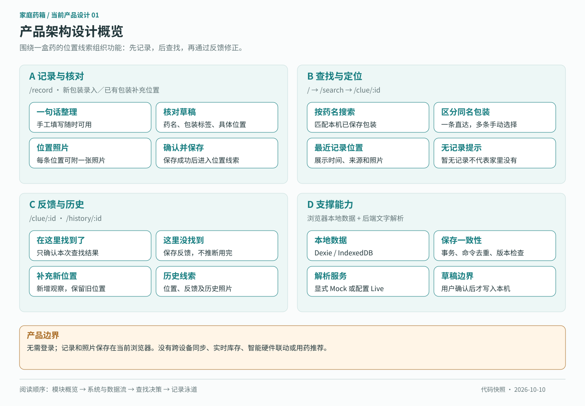
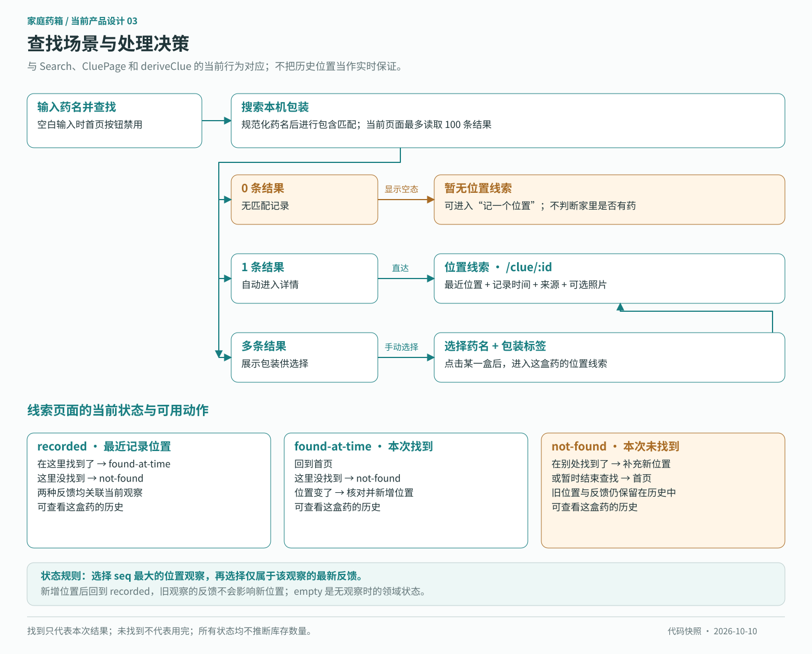
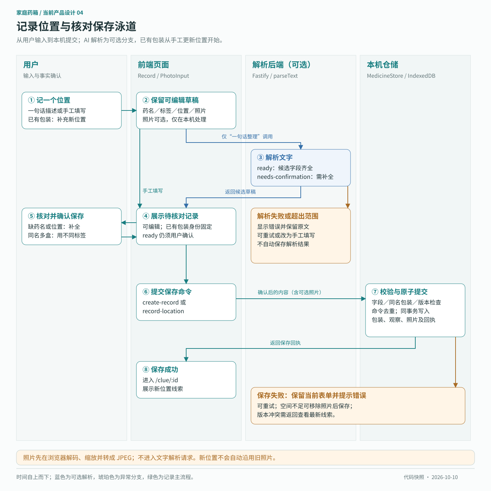
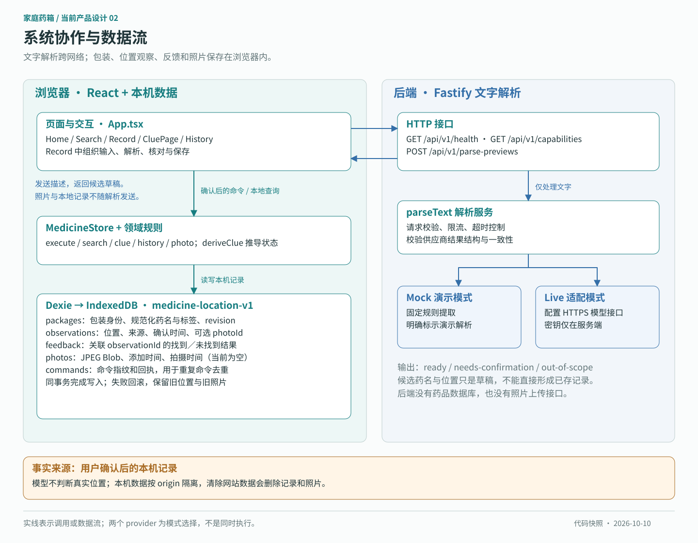

# 家庭药箱 · 位置线索

**记下这盒药放在哪里，为下次查找留一个起点。**

面向「年轻人 × 家庭常备药」的产品实践 Demo。用户整理药品时，用一句话或手工留下位置，可附一张现场照片；需要找药时，按药名查看历史线索，并在位置变化后补充新记录。

**已实现：** 记录、核对、查找、照片、查找反馈与历史回顾。<br/>
**体验方式：** 本机运行，无需账号；默认演示解析，无需模型密钥。

[快速运行](#快速运行) · [演示路径](#两分钟演示路径) · [验证与下一步](#验证与下一步) · [设计与开发资料](#设计与开发资料)

## 为谁解决什么问题

目标用户是 **25–35 岁、无长期固定用药管理需求的年轻人**：家中有常备药，但很少集中整理；药品可能分散在药箱、抽屉、背包等位置，使用时往往靠记忆翻找。

> 当我已经知道要找哪盒药，却想不起放在哪里时，希望有一条可追溯的线索，帮助我决定先去哪里找。

| 用户遇到的问题 | 本版的设计回应 |
| --- | --- |
| 记得有这盒药，却忘了具体位置 | 按药名查找最近记录的位置，并显示记录时间和来源 |
| 不愿每次拿取都登记，维护容易中断 | 在整理或实际找到时顺手记录；不要求逐次维护库存 |
| 同名药品有多盒，容易混淆 | 用“家用盒”“随身盒”等包装标签区分 |
| 文字描述不够直观 | 可附收纳现场照片，辅助辨认抽屉、口袋或容器 |
| 按旧位置没找到，不知道下一步怎么做 | 保存未找到反馈，允许结束查找；在别处找到后更新位置 |

这一方向来自[单人探索性访谈](docs/research/P01_家庭备用药收纳与找药_探索性访谈.md)，可先阅读[研究摘要](docs/research/家庭备用药收纳与找药_探索性研究摘要.md)。目前属于待验证的产品判断，尚不能证明普遍需求或找药效率提升。

## 产品取舍：先做好一次查找

第一版聚焦 **“留下线索 → 按线索寻找 → 根据结果修正”**。药箱是主要收纳点和整理入口；药箱之外的位置由用户记录，不假设硬件能自动感知。



- **记录要轻：** 手工可直接完成；一句话整理降低填表负担，照片可选。
- **依据要清楚：** 显示位置、时间与来源，让用户判断线索是否值得参考。
- **失效后可继续：** 未找到也能完成反馈，不要求用户编造新位置。
- **历史要保留：** 新位置成为最新线索，原位置、照片和查找反馈仍可回看。

产品承诺是提供查找起点。**历史位置不等于实时定位；无记录不等于家里没有；未找到不等于已经用完。** 本版不包含诊断、选药、剂量建议，也不扩展库存数量、过期提醒、补货、多人同步或真实硬件联动。

## 核心体验

### 找药：给出依据，也给出下一步

输入已知药名后，无匹配时解释“暂无位置线索”；匹配到一盒时直接查看；同名多盒时先选包装。用户实际寻找后，可以反馈找到、未找到，或在别处找到后更新位置。



### 记位置：先核对，再成为正式记录

一句话或手工输入都经过核对保存。照片与这次位置记录绑定，更新位置时不会自动沿用旧照片；保存失败会保留当前页面的草稿，允许重试。



### AI 的作用：整理输入，不替用户认定事实

AI 只将文字整理为待核对的药名和位置，不推测未记录的移动，不决定药品是否仍在。信息不明确时由用户补充；解析失败时可以继续手工填写。

| 能力模式 | 当前状态 |
| --- | --- |
| 演示解析 `mock` | 默认开启，有限句式的确定性解析；界面明确标注未调用真实 AI |
| 真实解析 `live` | 已实现服务端适配、输出校验与超时处理；需配置模型服务，尚未完成真实模型实测 |
| 手工录入 | 不依赖解析服务，可独立完成整个流程 |

需要验证的关键问题是：**一句话输入加核对的总成本，是否低于直接填表？** Mock 只能验证流程，不能作为模型准确率的证据。

## 快速运行

需要 **Node.js 22.12+ 和 npm**；本次验证环境为 Node.js 22.21.0。下载或解压源码后，在项目根目录执行。

### 推荐：构建后演示

```bash
npm ci
npm run build
npm start
```

打开 [http://127.0.0.1:3001](http://127.0.0.1:3001)。一个服务同时提供页面和解析接口，默认无需配置密钥。按 `Ctrl+C` 停止。

### 开发模式

```bash
npm ci
npm run dev
```

打开 [http://127.0.0.1:5173](http://127.0.0.1:5173)。前端使用 5173，后端使用 3001；请避免同时启动两种模式占用端口。

**演示时始终使用同一地址。** 浏览器按域名和端口隔离数据，5173、3001、localhost 与 127.0.0.1 的记录不会互通。本机地址不能直接发给他人访问，对方需取得源码后运行。

### 可选：接入真实模型

将根目录 `.env.example` 复制为 `.env`，填写后重启：

```dotenv
AI_MODE=live
AI_URL=https://your-provider.example/v1/chat/completions
AI_KEY=your-server-side-key
AI_MODEL=your-model-name
```

服务需兼容 HTTPS Chat Completions JSON 模式并返回 `choices[0].message.content`。密钥由后端读取；live 模式会将输入文字发送给配置的服务，照片不上传。不要将含密钥的 `.env` 放入提交包。

## 两分钟演示路径

1. **留下线索：** 点击“记一个位置”，输入“这盒布洛芬放在黑色背包前袋”，点击“整理为待核对记录”。
2. **确认保存：** 检查药名、位置，填写“随身盒”标签；可选一张位置照片，确认保存。
3. **查找核验：** 回首页搜索“布洛芬”，查看位置、记录时间和来源。
4. **处理失效：** 点击“这里没找到”，再选择“在别处找到了，更新位置”，填写“行李箱内侧袋”。
5. **查看结果：** 打开历史，确认旧位置、未找到反馈和旧照片仍被保留；刷新后已保存记录仍可查询。

进一步体验：新增“家用盒”标签的同名药，查看包装选择；搜索未记录的药名，查看空态说明。以上药名仅用于演示记录与查找。

照片功能支持 JPEG、PNG、WebP；手机可尝试相机入口，桌面使用选图。未保存草稿刷新后会丢失；清除网站数据会删除本机记录和照片。

## 系统如何支撑产品

采用 **React + TypeScript + Vite、Fastify、Dexie / IndexedDB**。本机记录是展示依据，后端只负责文字解析；无需部署药品数据库即可运行 Demo。



| 目录 | 职责 |
| --- | --- |
| `apps/web/src/App.tsx`、`styles.css` | 页面、任务流程和视觉样式 |
| `apps/web/src/domain` | 包装、位置、反馈与状态规则 |
| `apps/web/src/infrastructure` | 本机数据及照片的原子保存、幂等与版本冲突检测 |
| `apps/api/src` | HTTP 校验、限流、解析服务与模型适配 |
| `packages/contracts` | 前后端共享的数据契约 |
| `tests/e2e` | 浏览器完整流程验收 |

UI 参考 [Figma 设计](https://www.figma.com/design/dfvVgUOd3g8gj5vfjOcoLO/Untitled?node-id=0-1)，采用浅色背景、清晰的信息层级和蓝色主操作，优先适配移动端。Noto Sans SC 字体随应用本地加载。

## 验证与下一步

已记录的开发验收结果：**29 条单元/接口测试、9 条 Chromium 浏览器测试通过，类型检查和构建通过。** 构建版本另验证了深链接、保存、刷新恢复与页面运行错误。详情见[开发与验证记录](docs/开发/开发与验证记录.md)。

```bash
npm test
npm run typecheck
npx playwright install chromium
npm run test:e2e
```

端到端测试自动启动开发服务，使用隔离浏览器数据。报告位于 `playwright-report/`，截图与失败跟踪位于 `test-results/`；两者均为可重新生成的本地产物，不提交到 Git。构建服务启动后，可另执行 `node tests/production-smoke.mjs` 验证交付版本。

自动化验证覆盖了记录持久化、同名包装、照片历史、失败重试、并发冲突及解析回退。**真人可用性、真实模型质量和手机相机尚未实测。**

下一轮优先邀请目标用户完成一次独立试用，观察能否理解“历史位置”、处理“未找到”，以及是否愿意在自然整理时留下记录。最重要的假设仍是：后续查找的收益能否超过记录与维护成本。

## 设计与开发资料

- [竞品与替代方案分析](docs/research/家庭药品位置线索_竞品与替代方案分析.md)：7 个产品及固定收纳、备忘录的比较，含真实来源、设计建议与待验证差异。
- [初步产品设计](docs/初步产品设计.md)：问题定义、设计取舍与验证计划，保留早期方案状态。
- [用户故事](docs/开发/用户故事.md)：任务拆分与验收条件。
- [当前产品图解](docs/开发/当前产品图解.md)：本页四张 SVG 的说明及代码对照。
- [前后端设计与开发方案](docs/开发/前后端设计与开发方案.md)：技术选型与分层设计。
- [开发与验证记录](docs/开发/开发与验证记录.md)：实际交付范围、修订过程与未验证边界。

开发工具：Codex、Figma MCP、Vitest、Playwright；使用 backend-patterns、api-design、test-driven-development 技能。
