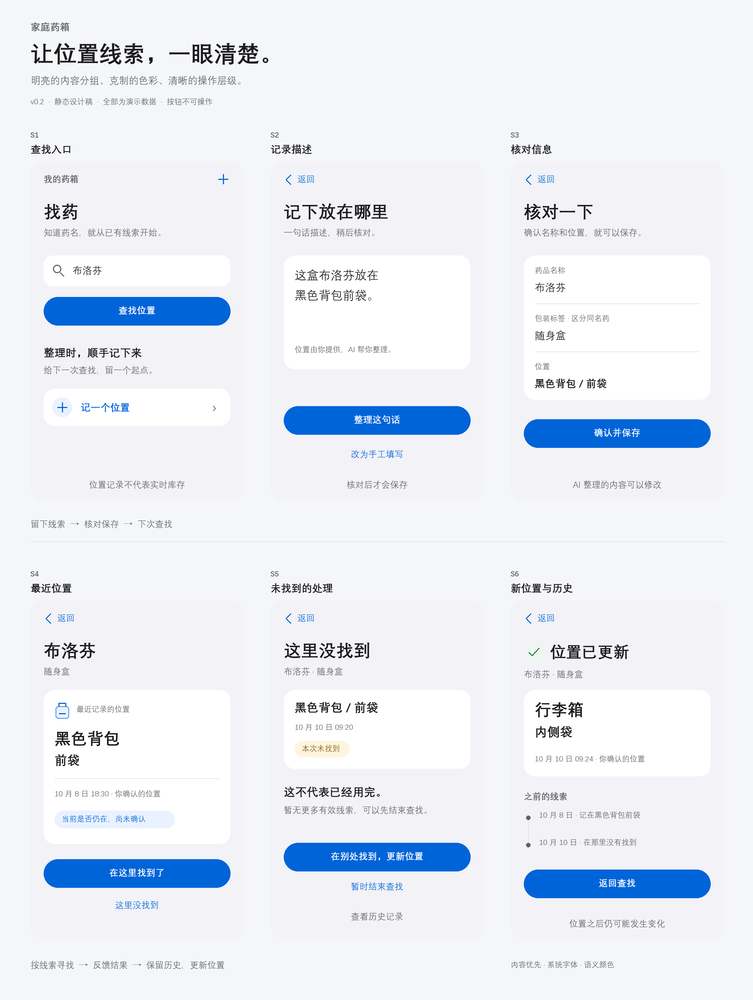

# 家庭药箱位置线索 初步产品设计

版本：0.3 · 日期：2026-10-10 · 状态：待评审的设计方案，尚未开发或验证；新增位置照片需求，现有六屏视觉稿仍为 v0.2。

本方案面向场景 C「年轻人 × 家庭常备药」，帮助已经知道药名的用户依据历史线索决定先去哪里找，并在找不到时修正记录。核心假设是：低频记录带来的查找收益能够超过录入与纠错成本。

## 文档关系与当前进度

- [竞品与替代方案分析](research/家庭药品位置线索_竞品与替代方案分析.md)：2026-10-11 补充，比较位置收纳、药品管理与服药产品；产品差异和效果仍需实测。
- [MVP 决策草案](MVP%20决策草案.md)：保留选题依据、候选方案取舍和原始假设；不删除，也不将其中假设改写成验证结论。
- 本文：承接决策，提出页面、业务规则、实现边界和验收方法。后续设计细节以本文维护；若验证改变方向，再同步更新决策草案并记录原因。
- [探索性访谈](research/P01_家庭备用药收纳与找药_探索性访谈.md)和[研究综述](research/家庭药品管理_公开研究与方案证据综述.md)：作为证据来源，不重复扩写。
- [原型图 SVG](prototype/位置线索原型.svg) / [预览 PNG](prototype/位置线索原型.png)：六个核心界面状态的静态线框稿。不是可点击 Demo；所有药品、位置和时间均为演示数据。

当前完成了探索性材料、MVP 草案与初步设计；尚无应用代码、真实模型接入、可运行 Demo 或用户测试结果。

## 1 用户与核心任务

目标用户：无长期固定用药管理需求，药品分散在住处与随身物品中，不愿逐次登记存取，需要寻找一种已明确药品的年轻人。

任务陈述：当我想找到已有的某盒药，却想不起放在哪里时，希望获得有来源的位置线索，决定先查哪里；线索失效后，能够纠正它。

现有依据：P01 I09、I10 支持跨位置翻找与去向不明；I11 提示维护意愿低。均为单人自述。尚未证明普遍需求、找药效率改善、减少重复购买或过期浪费。

产品承诺限定为“提供查找起点”，不承诺实时定位或准确库存，不提供诊断、选药、剂量和治疗建议。

## 2 药箱与智能能力的角色

药箱暂定为家庭主要收纳点和整理入口。用户整理药箱时，可记录一盒药留在药箱中，或已经放到随身容器中；柜外位置依靠用户提供，不假定硬件可以感知。

这一角色与题目有关，但药箱的必要性仍待验证：若用户只需要普通备忘录，不能宣称已证明智能硬件价值。第一版不增加贴标、摄像头、称重或 RFID 演示。

AI 用于将一句自然语言整理成待核对的药名和位置。AI 不保存事实、不选择查找地点、不推测未记录的移动。所有正式记录经过用户核对。

与替代方案比较：固定收纳无软件维护成本；备忘录轻便；本方案尝试通过结构化查找、记录来源与失效反馈增加价值。AI 与手工表单应比较输入、等待、核对和纠错的总成本。

## 3 最小范围

| 必须实现 | 验收结果 |
| --- | --- |
| 自然语言或手工录入 | 不完整信息可以补填，原文保留 |
| 核对与保存 | 未确认不入库，保存失败不显示成功 |
| 按药名查找 | 只返回已有记录；无匹配不猜测位置 |
| 查看位置线索 | 显示时间、来源和是否有后续查找反馈 |
| 找到与未找到反馈 | 新增观察记录，不改写原始历史 |
| 找到后更新位置 | 新记录成为最近线索，旧记录仍可查看 |
| 持久化 | 刷新后仍可查询已确认记录 |
| 可选位置照片 | 拍照或选图后核对保存，查询时辅助辨认位置；照片不代表实时状态 |

暂缓：账户、多人同步、实时数量、有效期提醒、补货、OCR、语音、医学问答、真实硬件和后台管理。

用户新增的位置照片纳入第一版，但不强制每条记录附图。每次位置观察可附一张收纳现场照片，支持预览、替换、移除和查询时放大。照片与具体包装、具体观察绑定；更新位置不沿用旧照片。首版本地保存，不进行 GPS 定位或 AI 图像识别。拍摄时间未知时明确显示未知，并与添加/确认时间分开。具体验收见[用户故事 US-12](开发/用户故事.md#us-12-拍照留下位置线索)。

首版按可区分包装建档；同名包装已有记录时，必须选择已有包装或明确新增，并填写区分标签。原型用“随身盒”作为示例，不实现自动包装识别。

## 4 核心流程与原型

记录分支：S1 查找入口 → S2 记录描述 → S3 核对 → 保存 → S4 位置线索。

查找分支：S1 输入已知药名 → 匹配包装 → S4 位置线索 → 实际寻找。

异常分支：S4 这里没找到 → S5 未找到 → 在别处找到后填写位置 → S6 更新完成。也允许暂时结束，不要求为了完成流程编造新位置。

找到分支：S4 在这里找到了 → 新增该位置的确认观察 → 保留位置卡，显示本次确认时间。

| 页面 | 主要内容与行为 |
| --- | --- |
| S1 找药 | 药名输入框、查找按钮、记位置入口；新用户显示引导，不制造已有记录 |
| S2 记位置 | 一句话输入、手工填写入口；提交后显示处理中并阻止重复提交 |
| S3 核对 | 可编辑药名、包装标签和位置；确认后才保存；返回保留草稿 |
| S4 线索 | 药名与包装、最近位置、时间、来源、仍在与否未确认；提供两种查找反馈 |
| S5 未找到 | 明确该位置本次未找到，不等于药已用完；允许更新位置、查看历史或暂时结束 |
| S6 更新完成 | 新位置与确认时间；历史中保留原线索和失败反馈；返回查找 |

图中六屏是用于评审的状态快照，并非六个独立路由。优先采用一个主页面和录入/核对面板实现。

照片需求尚未绘入上述 v0.2 原型：需补充 S2/S3 的拍照或选图、预览与移除状态，S4 的照片缩略图和放大状态，以及新位置编辑时的可选照片。位置照片失效时随原线索显示状态，不能作为仍在原处的证明。

## 5 状态和异常规则

| 触发 | 产品反馈 | 规则 |
| --- | --- | --- |
| 未记录该药 | 暂无位置线索，可以在实际找到后记录 | 不把无记录解释成家里没有 |
| 只有历史记录 | 最近记录在某处，当前是否仍在未确认 | 显示真实记录时间，不伪造置信度 |
| 按线索未找到 | 本次未找到，暂无更多有效线索 | 不写入零库存；不自动让更旧记录成为可靠推荐 |
| 同处找到 | 显示本次找到的时间 | 仅代表当时观察，不保证未来仍在 |
| 别处找到 | 新增位置记录 | 旧记录与失败反馈不删除 |
| 模糊输入或缺字段 | 高亮需补充字段，等待确认 | “包里”可以保留原意，不能补成黑色背包前袋 |
| 同名多盒 | 选择包装或新建有标签的包装 | 不按药名覆盖实物 |
| AI 超时或失败 | 原文保留，可重试或手工填写 | 可见标明实际使用的能力模式 |
| 存储失败 | 未保存，保留草稿并提供重试 | 不进入完成页 |

已有较早记录可以查看，但明确标记“历史记录，不代表仍在”。第一版没有自动推荐第二个地点。

“找到了”会记录一次观察；若药随后被拿走，应用并不知道。用户可以主动更新位置，但不得把逐次更新设置为使用前提。

## 6 信息与视觉设计

移动端优先，原型按 390px 内容宽度表达。使用清晰中文、单列布局和文字状态；主要操作高度为 52px。正式实现须检查窄屏换行、文字放大、键盘操作和焦点可见性。

首屏优先找药；记录是次级入口。结果按“位置 → 时间和来源 → 状态 → 下一步”排序。未找到使用温和提示，避免用红色暗示药品危险或缺货。

本版参考 Apple HIG 的可读性、内容层级和一致的语义颜色原则：浅灰分组背景、白色内容表面、深色正文、蓝色主操作；未找到采用琥珀色文字标签，更新完成采用小面积绿色确认符号，状态同时用文字表达。具体颜色为本项目选择，不是 Apple 官方色值复刻。

使用系统字体栈：Apple 设备优先系统字体与 PingFang SC，Windows 静态 PNG 采用等线字体替代，SVG 随查看设备回退。避免将替代字体宣称为 SF Pro。页面标题 32px，正文 17px，辅助文字 14px；通过字号、字重与间距分层。主按钮居中，次级操作改为文字入口，核对表单采用连续分组行，历史记录采用时间线。

配色与字号见 [tokens.css](prototype/tokens.css)。原型仍为固定尺寸静态稿，尚未验证动态字体、响应式和交互无障碍。SVG、2倍分辨率 PNG 与 S1—S6 单屏预览由 `prototype/render_v2.py` 生成；旧生成器保留为最初线框稿来源，更新本版请使用新脚本。

参考：[Apple 字体概览](https://developer.apple.com/documentation/technologyoverviews/fonts)、[HIG 色彩](https://developer.apple.com/design/human-interface-guidelines/color)、[HIG 排版](https://developer.apple.com/design/human-interface-guidelines/typography)。本稿是受其原则启发的产品设计，并非原生系统组件实现或官方认证。

可参考 [shadcn/ui](https://ui.shadcn.com/docs/components) 的表单与反馈组件；[HomeBox](https://github.com/sysadminsmedia/homebox) 用于观察物品和位置组织，[Grocy](https://grocy.info/) 用于比较库存维护负担。仅借鉴机制，未采用其代码或验证其适配性。

## 7 实现结构建议

采用单个小应用，逻辑分层不要求拆成多个服务。技术栈候选为 React、TypeScript 和 Vite；本地存储满足单设备原型。真实模型调用通过服务端保管密钥。

| 层 | 职责 | 不承担的职责 |
| --- | --- | --- |
| 界面 | 展示、输入、核对、反馈 | 不推断库存，不直接调用带密钥的模型 |
| 任务流程 | 组织记录、查找、确认、纠正 | 不依赖具体存储或模型供应商 |
| 业务规则 | 包装区分、字段校验、状态推导 | 不调用模型作事实判断 |
| 适配 | 存储、真实解析或标明的 Mock | 不跳过用户确认 |

最小数据对象：包装（ID、药名、区分标签）；位置观察（ID、包装 ID、位置、确认时间、来源）；查找反馈（关联观察 ID、找到/未找到、时间）。AI 解析稿为临时数据，确认后来源标为“用户确认，AI 辅助整理”。

位置观察另可关联一张本地照片，保存图片引用、添加时间和可确认的拍摄时间；未知拍摄时间不补造。图片与文本的保存成功状态必须一致，失败时保留草稿；用户可明确移除照片后只保存文字。存储选型需覆盖图片，不能仅按纯文本记录设计。

线索展示由最近观察及其后续反馈推导。后续新增位置观察后，旧反馈不应使新位置失效。时间存储须带时区或统一为 UTC，显示时转换为用户当地时间。

## 8 验证与验收

以下均为计划，尚未执行。

程序验收：输入核对保存后刷新仍存在；未找到不改变数量；新位置不覆盖旧历史；同名两盒不互相覆盖；无记录不猜位置；解析与存储失败均可恢复；快速重复提交不产生重复记录。

智能验证：使用明确描述、缺位置、含糊指代、同名多盒和服务失败样例。记录字段是否忠于原文、是否要求补充、纠错次数。Mock 只验证交互，不计入真实模型准确率。

用户试走：让目标用户独立记录一个实际位置，查询线索，解释“最近记录”含义，再处理未找到异常。记录完成情况、求助、误解和操作耗时。首次可做一人探索；后续增加独立参与者寻找反例，不将小样本比例当作总体结论。

价值验证：观察自然找药与自然记录时机。情境试走只能验证交互；同一物品重复查找存在记忆效应。若固定收纳已经足够，或核对维护成本超过收益，应缩小或停止该方向。

优先修复条件：把历史位置理解为当前保证；未找到后误以为已经用完；没有愿意记录的自然时机。前两项调整文案与流程，后一项需要重新考虑方案机制。

## 9 开发顺序与提交对照

1. 评审本稿与原型，确认药箱角色、录入时机和失败后的动作。
2. 先以手工录入和本地存储跑通闭环，再接入智能解析适配。
3. 实现未找到、纠正、无记录和失败恢复，完成规则与操作检查。
4. 做一次用户试走，保存实际观察及修改记录。
5. 提交产品说明、可运行 Demo 与源码/运行说明、复盘；注明 AI/Coding 工具、Mock 范围和实际总投入。

本稿覆盖产品设计和验证计划，SVG 覆盖静态原型表达；二者均不能替代题目要求的可运行 Demo 和实际复盘。若再给两小时，优先检查低频记录在后续查找时是否仍有价值。
